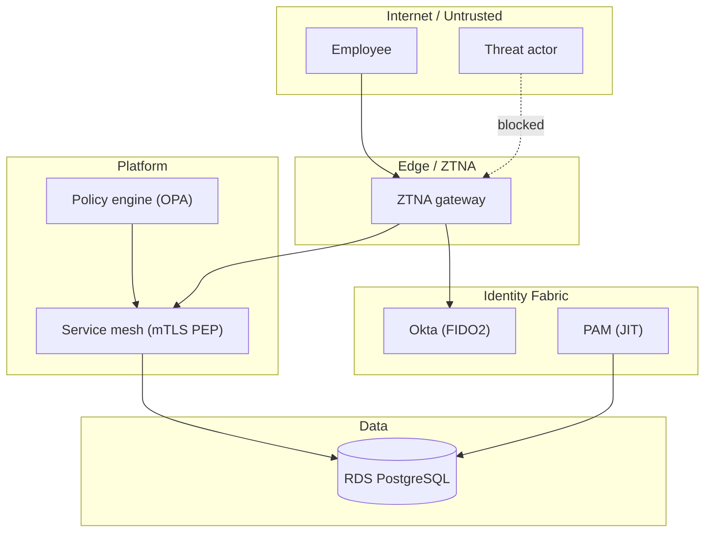

# Zero Trust Architecture Skill

A Claude Code skill for designing, policy-testing, assessing, threat-modeling, and mapping Zero Trust architectures. It is aligned with **NIST SP 800-207** (the default reference) and the **CISA Zero Trust Maturity Model v2 (ZTMM)**.

It covers six workflows:

| Workflow | Use it for | Main outputs |
|----------|-----------|--------------|
| Architecture design | New target-state architectures | Design doc, Mermaid diagrams, component inventory, migration plan |
| Policy creation | OPA/Rego and Cedar access policies | Policy files, tests, decision logs |
| Implementation | Platform rollout (Cloudflare, Zscaler, Okta, AWS, ...) | Runbook, Terraform/CLI snippets, validation checklist |
| Assessment | Maturity scoring and gap analysis | Scorecard, gap analysis, roadmap, KPIs |
| Threat modeling | STRIDE and MITRE ATT&CK mapped to ZT tenets | Threat model, attack trees, mitigations, validation tests |
| Compliance mapping | NIST 800-207 to NIST 800-53 Rev 5 and FedRAMP High | Control matrix, evidence checklist, cATO outline |

## Repository layout

```
SKILL.md                    Skill entry point (workflows, rules, quality gates)
references/                 Reference material (NIST 800-207, CISA ZTMM, patterns, vendors, policy languages, threat modeling)
templates/                  Document and policy starting points (design doc, Rego, Cedar, threat model, ...)
scripts/                    Deterministic helpers (validators, scorers, generators, mappers)
examples/                   Sample inputs for the scripts
evals/                      Five evaluation cases: prompt, case.yaml, graders/assertions.txt
requirements.txt            Python dependencies
```

## Requirements

- **Python 3.9+**
- **PyYAML**: `pip install -r requirements.txt`. Needed by `score-maturity.py` (loads YAML input) and `map-compliance.py --format yaml`.
- **OPA 1.x** (for `validate-rego.py` and `opa test`): `brew install opa`
- **Cedar CLI** (for `validate-cedar.py`): `cargo install cedar-policy-cli` (needs Rust, `brew install rust`). Tested with cedar-policy-cli 4.14.0. The validator also finds `~/.cargo/bin/cedar` without a PATH change.

Rego files must use **OPA v1 syntax**: `allow if { ... }`, `deny contains msg if { ... }`, `default allow := false`. The old v0 form (`allow { ... }`) does not parse on OPA 1.x.

## Quick start

```bash
git clone https://github.com/raaammm08/zero-trust-architecture.git
cd zero-trust-architecture
pip install -r requirements.txt
```

Then use the skill from Claude Code. Invoke it by mentioning Zero Trust, ZTNA, NIST 800-207, CISA ZTMM, OPA/Cedar policies, micro-segmentation, threat modeling, or compliance mapping. The workflow in `SKILL.md` takes over from there.

## Running the scripts

Every script takes `-h` for full help. Examples below use the bundled sample inputs.

### 1. Architecture diagrams (`generate-mermaid.py`)

Turns an architecture YAML (zones and components) into Mermaid.

```bash
python3 scripts/generate-mermaid.py examples/architecture-example.yaml --type architecture -o architecture.mmd
python3 scripts/generate-mermaid.py examples/architecture-example.yaml --type dataflow -o dataflow.mmd
python3 scripts/generate-mermaid.py examples/architecture-example.yaml --type matrix -o matrix.mmd
```

Output (`architecture.mmd`) is a `graph TB` with one `subgraph` per trust zone, component nodes, connections, and zone colors. Paste it into any Mermaid renderer, or into a GitHub Markdown code block tagged `mermaid`.

Every label is quoted, and double quotes inside labels become `#quot;`, so commas, parentheses, pipes, and brackets are safe.

Simplified example of the kind of diagram this produces (from the fintech design run):



### 2. Policy validation (`validate-rego.py`, `validate-cedar.py`)

```bash
python3 scripts/validate-rego.py templates/policies -o rego-report.json
python3 scripts/validate-cedar.py templates/policies -o cedar-report.json
```

`validate-rego.py` runs OPA syntax checks on the policies in the directory and writes a JSON report. It exits `1` when it finds errors. Example result from the bundled Rego template:

```json
{'policies_checked': 1, 'tests_run': 0, 'tests_failed': 0}
```

The template passes `opa check`. Add `*_test.rego` files next to a policy to get test results.

`validate-cedar.py` checks each `.cedar` policy against the schema (`*.cedarschema` or `*schema*.json`). With no schema it runs syntax-only checks and prints a warning. It then runs every test case in a `*tests*.json` file and exits 1 if any decision differs from its expected `ALLOW`/`DENY`. The template ships with `cedar-schema.cedarschema` and `tests/cedar-tests.json` (13 cases), all passing.

### 3. Maturity scoring (`score-maturity.py`)

Input: a YAML file with one stage per sub-capability. Stages are `traditional`, `initial`, `advanced`, or `optimal`. Each pillar's stage is its weakest sub-capability (weakest-link scoring). See `examples/sample-assessment.yaml` for the full structure.

```bash
python3 scripts/score-maturity.py examples/sample-assessment.yaml -o scorecard.md --format markdown
python3 scripts/score-maturity.py examples/sample-assessment.yaml -o scorecard.json --format json
```

Example console summary (from the CISA eval assessment, which covers all 35 sub-capabilities):

```
Overall: Traditional (1.0/4.0)
  Identity: Traditional (1.60)
  Device: Traditional (1.40)
  Network: Traditional (1.20)
  Application/Workload: Traditional (1.40)
  Data: Traditional (1.40)
  Visibility & Analytics: Traditional (1.00)
  Automation & Orchestration: Traditional (1.20)
```

Notes:

- The score is the weakest sub-capability, not an average. A pillar with one Traditional sub-capability is Traditional, even if the others are Advanced.
- An unknown stage name (for example, a typo like `iniital`) is an error and stops the run.
- A sub-capability you leave out is scored Traditional, and the script prints a warning for it.

### 4. Compliance mapping (`map-compliance.py`)

```bash
# Control matrix: NIST 800-207 tenets -> NIST 800-53 Rev 5 -> FedRAMP High
python3 scripts/map-compliance.py --framework fedramp_high --format csv -o control_matrix.csv
python3 scripts/map-compliance.py --framework fedramp_high --format json -o control_matrix.json

# Evidence checklist for an assessor
python3 scripts/map-compliance.py --evidence-checklist fedramp_high -o evidence_checklist.csv

# One tenet's mapping
python3 scripts/map-compliance.py --tenet 3
```

Example CSV header and first row:

```
ZT Tenet,Tenet Number,ZT Implementation,NIST 800-53,FedRAMP High
All data sources and computing services are resources,1,"Automated asset discovery, CMDB with classification tags, ...",CM-8; CM-9; PM-5; RA-5; SA-12,CM-8; CM-9; PM-5; RA-5; SA-12
```

The framework flags are `nist_800_53`, `fedramp_high`, `cmmc_20_l3`, `iso_27001_2022`, `soc2`, `hipaa`, `pci_dss_40`, and `all`. Selecting `fedramp_high` always adds the NIST 800-53 base column.

The mapper's control mappings come from the script itself. Check them against the current NIST and FedRAMP baselines before an assessment.

### 5. Policy tests (`opa test`)

```bash
opa test -v path/to/policies
```

## Example: a policy with tests

The repo's template (`templates/policies/opa-rego-template.rego`) is a starting point. The JIT database access case from the evals is a complete example. Run `opa test -v` on it, and you should see:

```
data.jit.db_test.test_oncall_compliant_allowed: PASS
data.jit.db_test.test_offcall_denied: PASS
data.jit.db_test.test_nonengineer_denied: PASS
data.jit.db_test.test_noncompliant_device_denied: PASS
data.jit.db_test.test_missing_mfa_denied: PASS
data.jit.db_test.test_high_risk_denied: PASS
PASS: 6/6
```

The policy blocks access unless the user is an engineer in the on-call group, within the on-call window, with fresh phishing-resistant MFA, a compliant device, a corporate network or approved country, and acceptable risk scores. Each failed condition produces a named deny reason.

## Evaluations

`evals/` holds five cases covering the workflows above. Each case has:

- `prompt.md`: the task given to the skill
- `case.yaml`: expected outputs and success criteria
- `graders/assertions.txt`: the checks to apply to the outputs

| Case | Workflow |
|------|----------|
| `design-fintech-startup` | Architecture design (SOC 2 timeline) |
| `assess-cisa-ztmm` | CISA ZTMM assessment |
| `compliance-fedramp` | FedRAMP High mapping |
| `policy-jit-db-access` | JIT database Rego policy |
| `threat-model-microservices` | Threat model for an EKS platform |

The repo does not ship an automated runner. To grade a run, check each assertion in `graders/assertions.txt` against the outputs, and run `opa test` for the policy case.

Results from our last run, against the corrected assertions: 133 of 133 pass. Two expectations were changed from the original versions, because they contradicted the skill's own rules. See the commit history for details.

## Known limitations

- Generated Mermaid is checked with the Mermaid 11 parser (`mermaid.parse`) for the bundled examples and a set of labels with quotes, pipes, and brackets. It has not been checked visually in a renderer.
- The narrative deliverables (design docs, gap analyses, roadmaps) are generated by the model from your inputs. The scripts check structure; a human still needs to review the content, especially control mappings and vendor claims.
- Vendor FedRAMP authorization status and FIPS 140-3 validation are not checked by any script. Verify them yourself for every cloud service in your boundary.

## License

No license file is included yet. Add one before accepting outside contributions or reuse.
