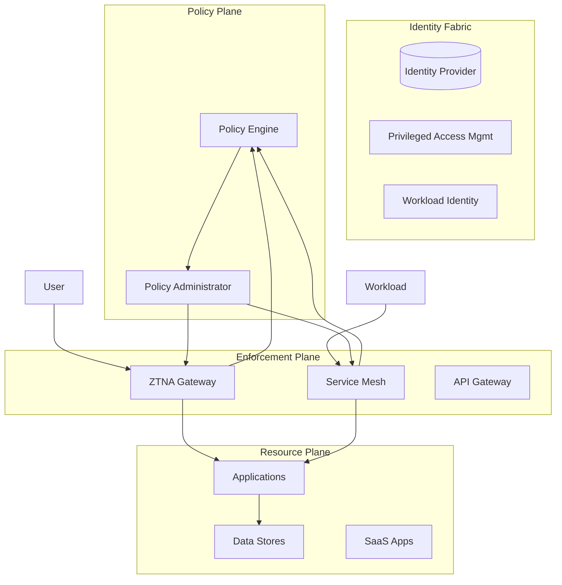

# Zero Trust Architecture Design Document

**System**: [System Name]
**Version**: [1.0]
**Date**: [YYYY-MM-DD]
**Author**: [Name]
**Classification**: [Public/Internal/Confidential/Restricted]

---

## 1. Executive Summary

[Brief overview of the architecture, key decisions, and target maturity state]

## 2. Scope & Context

### 2.1 In Scope
- [Systems, applications, networks, data stores]

### 2.2 Out of Scope
- [Explicitly excluded systems]

### 2.3 Assumptions
- [Key assumptions driving design]

### 2.4 Constraints
- Regulatory: [FedRAMP, HIPAA, PCI, etc.]
- Technical: [Legacy systems, vendor contracts]
- Organizational: [Team structure, skills, budget]
- Timeline: [Target dates]

## 3. Requirements

### 3.1 Business Requirements
| ID | Requirement | Priority |
|----|-------------|----------|
| BR-01 | [e.g., Enable secure remote work for 2000 employees] | Must |
| BR-02 | [e.g., Achieve FedRAMP Moderate authorization] | Must |
| BR-03 | [e.g., Reduce blast radius of compromise] | Should |

### 3.2 Security Requirements (NIST 800-207 Tenets)
| Tenet | Requirement | Implementation Approach |
|-------|-------------|------------------------|
| 1. Resources | All assets inventoried and protected | CMDB + agentless discovery |
| 2. Secure Comms | All traffic encrypted, authenticated | mTLS + ZTNA + TLS 1.3 |
| 3. Per-Session | Access granted per session | JIT + short-lived tokens |
| 4. Dynamic Policy | Policy based on real-time context | OPA/Cedar + device posture |
| 5. Monitor Posture | Continuous asset monitoring | EDR + CSPM + UEBA |
| 6. Dynamic AuthZ | Strict enforcement before access | PDP/PEP separation |
| 7. Collect/Improve | Telemetry feeds analytics | SIEM + SOAR + ML |

### 3.3 Compliance Requirements
| Framework | Controls | Mapping Status |
|-----------|----------|----------------|
| [e.g., NIST 800-53] | AC-2, AC-3, SC-7, SI-4 | Mapped |
| [e.g., CISA ZTMM] | All 7 pillars | Target: Advanced |

## 4. Architecture Overview

### 4.1 High-Level Diagram


### 4.2 Trust Zones
| Zone | Description | Boundaries | Classification |
|------|-------------|------------|----------------|
| Internet | Untrusted | Public IPs | Public |
| DMZ / Edge | ZTNA/Gateway | Cloudflare/Zscaler PoPs | Internal |
| Identity | IdP, PAM, Governance | Dedicated VPC/Subnet | Restricted |
| Platform | Kubernetes, Service Mesh | Cluster network | Confidential |
| Application | Microservices, APIs | Namespace/Service | Confidential |
| Data | Databases, Object Store | Private subnets | Restricted |
| Visibility | SIEM, UEBA, SOAR | Isolated network | Restricted |

## 5. Component Design

### 5.1 Identity Fabric
| Component | Technology | Configuration |
|-----------|------------|---------------|
| Primary IdP | [Okta/Entra ID/Google] | [OIDC/SAML, MFA, lifecycle] |
| Directory Sync | [Entra Connect/Okta AD Agent] | [Scope, schedule] |
| MFA | [FIDO2/Push/TOTP] | [Phishing-resistant required for admins] |
| PAM | [CyberArk/BeyondTrust/Cloud] | [JIT, session recording, dual-control] |
| Workload Identity | [SPIRE/AWS IAM Roles Anywhere/GCP WIF] | [SPIFFE IDs, X.509/JWT] |
| Device Trust | [Intune/Jamf/CrowdStrike] | [Compliance policies, certificates] |

### 5.2 Policy Plane
| Component | Technology | Configuration |
|-----------|------------|---------------|
| Policy Engine | [OPA/Cedar/Verified Permissions] | [Decision API, bundles, caching] |
| Policy Admin | [GitOps/ArgoCD/Terraform] | [PR-based, automated testing] |
| Policy Language | [Rego/Cedar/Alpha] | [Versioned, tested, signed] |
| External Data | [REST/GraphQL/Kafka] | [Real-time attributes, caching TTL] |

### 5.3 Enforcement Points
| PEP | Scope | Technology | Mode |
|-----|-------|------------|------|
| ZTNA | User→App (North-South) | [Cloudflare Access/ZPA/Entra Private Access] | Proxy |
| Service Mesh | Workload→Workload (East-West) | [Istio/Cilium/Linkerd] | Sidecar |
| API Gateway | External→API | [Kong/Apigee/AWS API GW] | Proxy |
| Host Agent | Legacy/On-prem | [Osquery/Ossec/CrowdStrike] | Agent |

### 5.4 Resource Protection
| Resource Type | Protection |
|---------------|------------|
| Kubernetes | Admission control (Gatekeeper), runtime (Falco), network policies |
| Databases | Dynamic secrets (Vault), RLS, encryption, audit logging |
| Object Storage | Bucket policies, encryption, access logging, versioning |
| SaaS | CASB, DLP, conditional access, session controls |
| Legacy Apps | ZTNA + header-based auth, network segmentation |

## 6. Data Flows

### 6.1 User Access Flow
```
1. User → Browser → ZTNA Gateway
2. ZTNA → IdP (OIDC/SAML) → AuthN + MFA
3. ZTNA → Device Posture API → Compliance check
4. ZTNA → Policy Engine → Decision (allow/deny/step-up)
5. Policy Admin → ZTNA → Configure session (cert, headers)
6. User ↔ Application (mTLS, short-lived session)
7. Continuous: PEP → PE (re-evaluate on context change)
```

### 6.2 Workload Access Flow
```
1. Workload A → Service Mesh Sidecar
2. Sidecar → Policy Engine (SPIFFE ID + context)
3. PE → Decision + obligations
4. Sidecar A ↔ Sidecar B (mTLS, authorized)
5. Continuous: Sidecar → PE (re-evaluate)
```

## 7. Migration Phases

| Phase | Timeline | Scope | Success Criteria |
|-------|----------|-------|------------------|
| 1. Foundation | [Dates] | IdP, MFA, Device Inventory, Logging | 100% MFA, inventory complete |
| 2. ZTNA Pilot | [Dates] | Critical apps, pilot users | Zero VPN, user satisfaction |
| 3. Micro-Segmentation | [Dates] | DC/Cloud east-west | No implicit trust, encryption |
| 4. Workload Identity | [Dates] | Kubernetes, CI/CD | No static secrets in code |
| 5. Data Protection | [Dates] | Classification, DLP, Encryption | 100% classified, encrypted |
| 6. Advanced | [Dates] | Risk-based auth, UEBA, SOAR | Automated response >80% |

## 8. Risk Assessment

| Risk | Likelihood | Impact | Mitigation | Residual |
|------|------------|--------|------------|----------|
| Legacy app incompatible with ZTNA | High | High | App modernization / gateway | Medium |
| User resistance to MFA | Medium | High | Phased rollout, training, FIDO2 | Low |
| Policy complexity → errors | Medium | High | Policy testing, GitOps, staging | Medium |
| Vendor lock-in | Low | High | Standards-based, multi-cloud | Low |

## 9. Operations Model

### 9.1 Team Responsibilities
| Team | Responsibilities |
|------|------------------|
| Identity | IdP, MFA, PAM, lifecycle, governance |
| Platform | Service mesh, Kubernetes, workload identity |
| Network | ZTNA, micro-segmentation, DNS, connectivity |
| Security Engineering | Policy engine, threat modeling, red team |
| SOC | Monitoring, detection, response, UEBA tuning |
| Compliance | Evidence, audit, control mapping, reporting |

### 9.2 SLAs/SLOs
| Metric | Target |
|--------|--------|
| AuthN availability | 99.99% |
| Policy decision latency (p99) | <50ms |
| ZTNA session establishment | <2s |
| Incident detection (P1) | <5 min |
| Policy deployment (PR→prod) | <30 min |

## 10. Appendix

### 10.1 Decision Log
| Date | Decision | Rationale | Alternatives Considered |
|------|----------|-----------|------------------------|
| [Date] | [Decision] | [Why] | [Options] |

### 10.2 Glossary
- **ZTNA**: Zero Trust Network Access
- **PEP**: Policy Enforcement Point
- **PE**: Policy Engine
- **PA**: Policy Administrator
- **SPIFFE**: Secure Production Identity Framework For Everyone
- **JIT**: Just-In-Time
- **JEA**: Just-Enough-Access

### 10.3 References
- NIST SP 800-207
- CISA Zero Trust Maturity Model
- [Vendor documentation links]
- [Internal standards]