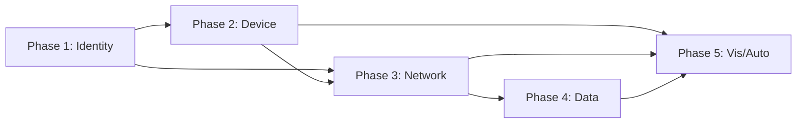

# Zero Trust Migration Plan

**Organization**: [Name]
**Version**: [1.0]
**Date**: [YYYY-MM-DD]
**Target Maturity**: [Initial/Advanced/Optimal per CISA ZTMM]

---

## 1. Current State Assessment

### 1.1 CISA ZTMM Baseline Scores
| Pillar | Current Stage | Evidence |
|--------|---------------|----------|
| Identity | [Traditional/Initial/Advanced/Optimal] | [Summary] |
| Device | [Traditional/Initial/Advanced/Optimal] | [Summary] |
| Network | [Traditional/Initial/Advanced/Optimal] | [Summary] |
| Application/Workload | [Traditional/Initial/Advanced/Optimal] | [Summary] |
| Data | [Traditional/Initial/Advanced/Optimal] | [Summary] |
| Visibility & Analytics | [Traditional/Initial/Advanced/Optimal] | [Summary] |
| Automation & Orchestration | [Traditional/Initial/Advanced/Optimal] | [Summary] |

### 1.2 Key Gaps
| Gap ID | Pillar | Description | Risk | Effort |
|--------|--------|-------------|------|--------|
| GAP-001 | Identity | No phishing-resistant MFA | Critical | Medium |
| GAP-002 | Device | No authoritative inventory | High | High |
| GAP-003 | Network | Flat network, VPN only | Critical | High |
| ... | ... | ... | ... | ... |

---

## 2. Migration Strategy

### 2.1 Approach
- [ ] **Big Bang**: All pillars simultaneously (high risk, fast)
- [ ] **Phased by Pillar**: One pillar at a time (lower risk, slower)
- [ ] **Phased by Environment**: Non-prod → Prod (recommended)
- [ ] **Hybrid**: Quick wins first, then phased

### 2.2 Sequencing Principle
1. **Identity First** — Foundation for all other pillars
2. **Device Second** — Context for policy decisions
3. **Network/Application** — Enforcement plane
4. **Data** — Protects crown jewels
5. **Visibility/Automation** — Operationalizes and scales

---

## 3. Phase Details

### Phase 0: Preparation (Weeks 1-4)
**Goal**: Establish foundation, governance, tooling

| Task | Owner | Deliverable | Criteria |
|------|-------|-------------|----------|
| Executive sponsorship & funding | CISO | Signed charter | Budget approved |
| ZT steering committee formed | PMO | Charter + RACI | Monthly cadence |
| Architecture review board | Arch | ADR template | First ADR approved |
| Tooling: Policy repo, CI/CD, testing | SecEng | Repo + pipeline | Policy test passes |
| Baseline assessment complete | All pillars | Gap analysis doc | All 7 pillars scored |
| Communication plan | PMO | Plan + templates | Stakeholders informed |

**Milestone**: **M0 - Foundation Ready**

---

### Phase 1: Identity Foundation (Weeks 5-12)
**Goal**: Strong authentication, unified identity, privileged access

| Task | Owner | Deliverable | Criteria |
|------|-------|-------------|----------|
| Consolidate IdPs (AD + Cloud) | Identity | Single IdP | 100% users in IdP |
| Deploy phishing-resistant MFA (FIDO2) | Identity | FIDO2 rollout | 100% admins, 80% users |
| Implement Conditional Access | Identity | CA policies | Risk-based, device-aware |
| Deploy PAM for all privileged access | Identity | PAM solution | 100% admin access via PAM |
| Implement JIT/JEA for cloud | Identity | Cloud PAM | Zero standing privileges |
| Workload identity (SPIRE/cloud-native) | Platform | SPIRE/IAM Roles Anywhere | No static keys in CI/CD |
| Identity governance (access reviews) | Identity | Quarterly reviews | 100% coverage |

**Milestone**: **M1 - Identity at Initial → Advanced**

**ZTMM Target**: Identity → **Advanced**

---

### Phase 2: Device Trust (Weeks 10-18)
**Goal**: Authoritative inventory, posture assessment, compliance

| Task | Owner | Deliverable | Criteria |
|------|-------|-------------|----------|
| Deploy unified endpoint management | Endpoint | MDM/UEM | 100% corporate devices |
| BYOD program with containerization | Endpoint | BYOD policy | Opt-in, data separation |
| Device certificate enrollment | Endpoint | Certificates | 100% managed devices |
| Real-time posture checks (EDR) | Endpoint | Posture API | Integrated with Policy Engine |
| Automated remediation (quarantine/wipe) | Endpoint | Playbooks | <5 min response |
| IoT/OT device profiling | Network | Inventory + segments | 100% discovered |

**Milestone**: **M2 - Device at Initial → Advanced**

**ZTMM Target**: Device → **Advanced**

---

### Phase 3: Network & Application Segmentation (Weeks 16-28)
**Goal**: Eliminate implicit trust, micro-segmentation, ZTNA

| Task | Owner | Deliverable | Criteria |
|------|-------|-------------|----------|
| Deploy ZTNA (replace VPN) | Network | ZTNA solution | VPN decommissioned |
| Micro-segmentation (DC + Cloud) | Network | Segmentation policy | Zero implicit trust |
| Service mesh (mTLS + AuthZ) | Platform | Istio/Cilium | 100% workloads meshed |
| API gateway + AuthZ | Platform | Gateway + policies | All APIs protected |
| Legacy app gateway / wrapper | App Teams | Reverse proxy / sidecar | No direct network access |
| DNS security (DNSSEC, DoH, filtering) | Network | DNS controls | 100% filtered |

**Milestone**: **M3 - Network & App at Initial → Advanced**

**ZTMM Target**: Network → **Advanced**, Application → **Advanced**

---

### Phase 4: Data Protection (Weeks 24-36)
**Goal**: Classification, encryption, DLP, data-centric security

| Task | Owner | Deliverable | Criteria |
|------|-------|-------------|----------|
| Data classification schema | Data | Schema + labels | 4-tier minimum |
| Automated classification (ML) | Data | Classifier | 80%+ accuracy |
| Encryption everywhere (CMK) | Data | KMS + policies | 100% encrypted |
| DLP (endpoint, network, cloud) | Data | DLP policies | 0 critical leaks |
| Information Rights Management | Data | IRM deployment | Sensitive docs protected |
| Data access governance | Data | Catalog + lineage | 100% critical data |

**Milestone**: **M4 - Data at Initial → Advanced**

**ZTMM Target**: Data → **Advanced**

---

### Phase 5: Visibility, Analytics & Automation (Weeks 30-48)
**Goal**: Continuous monitoring, UEBA, SOAR, GitOps

| Task | Owner | Deliverable | Criteria |
|------|-------|-------------|----------|
| Centralized logging (all pillars) | SecOps | SIEM/Lake | 100% sources |
| UEBA deployment | SecOps | UEBA models | <5% false positive |
| SOAR playbooks (top 20 scenarios) | SecOps | Playbooks | 80% auto-response |
| Policy-as-code + GitOps | SecEng | GitOps pipeline | 100% policy via Git |
| Automated compliance evidence | Compliance | Evidence collection | Continuous |
| Continuous authorization (cATO) | Compliance | cATO package | FedRAMP/OMB aligned |

**Milestone**: **M5 - Visibility & Automation at Initial → Advanced**

**ZTMM Target**: Visibility → **Advanced**, Automation → **Advanced**

---

### Phase 6: Optimization & Maturity (Ongoing)
**Goal**: Reach Optimal, continuous improvement

| Activity | Cadence | Owner |
|----------|---------|-------|
| Red team / purple team exercises | Quarterly | SecEng |
| Policy simulation / what-if | Monthly | SecEng |
| Maturity reassessment | Semi-annual | All pillars |
| Threat model updates | Per release | Arch |
| Zero Trust architecture review | Annual | CISO/Arch |

**ZTMM Target**: All pillars → **Optimal**

---

## 4. Timeline Summary (Gantt View)

```
Phase 0: Prep     ████
Phase 1: Identity     ████████
Phase 2: Device           ████████
Phase 3: Network/App           ████████████
Phase 4: Data                     ████████████
Phase 5: Vis/Auto                         ████████████
Phase 6: Optimize                                    ████████████ (ongoing)
Month:     1  2  3  4  5  6  7  8  9  10 11 12
```

---

## 5. Resource Requirements

| Role | Phase 0 | Phase 1 | Phase 2 | Phase 3 | Phase 4 | Phase 5 | Total FTE |
|------|---------|---------|---------|---------|---------|---------|-----------|
| Program Manager | 1.0 | 0.5 | 0.5 | 0.5 | 0.5 | 0.5 | 3.5 |
| Identity Engineer | 0.5 | 2.0 | 1.0 | 0.5 | 0.0 | 0.5 | 4.5 |
| Endpoint Engineer | 0.0 | 0.5 | 2.0 | 0.5 | 0.0 | 0.5 | 3.5 |
| Network Engineer | 0.5 | 0.5 | 0.5 | 2.0 | 0.5 | 0.5 | 4.5 |
| Platform Engineer | 0.5 | 1.0 | 1.0 | 2.0 | 1.0 | 1.0 | 6.5 |
| Data Engineer | 0.0 | 0.0 | 0.0 | 0.5 | 2.0 | 0.5 | 3.0 |
| SecOps Engineer | 0.5 | 0.5 | 0.5 | 1.0 | 1.0 | 2.0 | 5.5 |
| Compliance Analyst | 0.5 | 0.5 | 0.5 | 0.5 | 1.0 | 1.0 | 4.0 |
| **Total** | **3.5** | **5.5** | **6.0** | **7.5** | **6.0** | **6.5** | **35.0** |

---

## 6. Budget Estimate (Annual)

| Category | Year 1 | Year 2 | Year 3 |
|----------|--------|--------|--------|
| Personnel (FTE) | $3.5M | $3.5M | $2.5M |
| Identity (IdP, PAM, MFA) | $500K | $400K | $400K |
| Endpoint (MDM, EDR) | $300K | $250K | $250K |
| Network (ZTNA, Micro-seg) | $800K | $600K | $500K |
| Platform (Mesh, Gateway) | $400K | $300K | $250K |
| Data (DLP, Classification, KMS) | $600K | $400K | $350K |
| Visibility (SIEM, UEBA, SOAR) | $700K | $500K | $450K |
| Training & Change Mgmt | $200K | $100K | $50K |
| **Total** | **$7.0M** | **$6.05M** | **$4.75M** |

---

## 7. Success Metrics (KPIs)

| Metric | Baseline | Phase 1 | Phase 3 | Phase 5 | Target (Optimal) |
|--------|----------|---------|---------|---------|------------------|
| % Users on phishing-resistant MFA | 0% | 80% | 95% | 100% | 100% |
| % Devices managed & compliant | 20% | 50% | 90% | 99% | 100% |
| % Network traffic encrypted | 40% | 60% | 95% | 100% | 100% |
| % Workloads with mTLS + AuthZ | 0% | 20% | 80% | 100% | 100% |
| % Data classified & encrypted | 10% | 30% | 70% | 95% | 100% |
| Mean time to detect (MTTD) | 4 hours | 2 hours | 30 min | 5 min | <1 min |
| Mean time to respond (MTTR) | 2 hours | 1 hour | 15 min | 2 min | <30 sec |
| Policy deployment frequency | Monthly | Weekly | Daily | On-demand | Continuous |
| Audit findings (ZT-related) | 15 | 8 | 2 | 0 | 0 |

---

## 8. Risk Register

| Risk ID | Description | Probability | Impact | Mitigation | Owner |
|---------|-------------|-------------|--------|------------|-------|
| R-001 | Legacy apps break with ZTNA | High | High | App inventory, gateway wrappers, phased cutover | App Teams |
| R-002 | User productivity loss (MFA, device checks) | Medium | High | Phased rollout, self-service, FIDO2, communication | Identity |
| R-003 | Policy conflicts / lockouts | Medium | High | Staging env, policy testing, break-glass | SecEng |
| R-004 | Vendor delivery delays | Medium | Medium | Multi-vendor eval, contract SLAs, contingencies | PMO |
| R-005 | Skill gaps (OPA, Cedar, SPIRE) | High | Medium | Training, hiring, managed services | All |
| R-006 | Scope creep / boiling ocean | Medium | High | Strict phase gates, MVP per phase | PMO |

---

## 9. Communication Plan

| Audience | Message | Channel | Frequency | Owner |
|----------|---------|---------|-----------|-------|
| Executives | Strategic progress, risk, budget | Steering committee | Monthly | PMO |
| IT Leadership | Technical progress, dependencies | Sync meeting | Bi-weekly | PMO |
| Engineering Teams | Changes affecting them, action items | Slack + Email | Per phase | Team Leads |
| All Employees | What's changing, why, how to prepare | Town hall + Email | Phase milestones | PMO |
| Auditors/Compliance | Evidence, control mapping | Portal + Reports | Quarterly | Compliance |

---

## 10. Go/No-Go Criteria per Phase

| Phase | Go Criteria | No-Go Criteria |
|-------|-------------|----------------|
| 1 Identity | IdP consolidated, MFA >80%, PAM operational | <50% MFA, critical auth failures |
| 2 Device | >90% devices enrolled, posture API live | <50% enrolled, no EDR integration |
| 3 Network | VPN <10% usage, micro-seg pilot passing | VPN >50%, segmentation breaking apps |
| 4 Data | Classification schema live, DLP tuning | No classifier, DLP blocking business |
| 5 Vis/Auto | SIEM ingesting all, 5 playbooks auto | <50% log sources, 0 playbooks |

---

## 11. Appendix

### 11.1 Vendor Evaluation Scores
| Vendor | Category | Score | Notes |
|--------|----------|-------|-------|
| [Vendor] | [ZTNA/MDM/SIEM] | [1-5] | [Pros/Cons] |

### 11.2 Dependency Map


### 11.3 Break-Glass Procedures
- [Document emergency access procedures for each phase]
- [Time-bounded, audited, requires approval]

---

*Document controlled per [Policy Reference]. Review quarterly.*