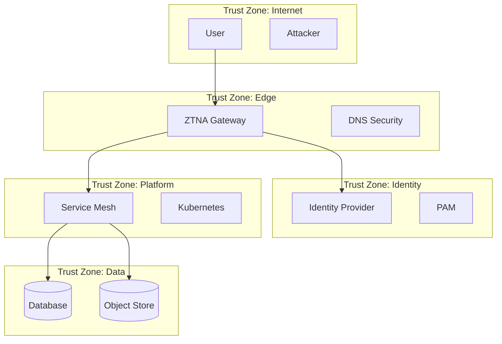

# Zero Trust Threat Model

**System**: [System Name]
**Version**: [1.0]
**Date**: [YYYY-MM-DD]
**Author**: [Name]
**Classification**: [Confidential/Restricted]
**Methodology**: STRIDE + MITRE ATT&CK + NIST 800-207 Tenets

---

## 1. System Overview

### 1.1 Scope
- **In Scope**: [Components, trust zones, data flows]
- **Out of Scope**: [Explicitly excluded]

### 1.2 Architecture Summary
[Reference architecture diagram - Mermaid or link]



### 1.3 Trust Zones & Boundaries
| Zone | Components | Trust Assumptions | Boundary Controls |
|------|------------|-------------------|-------------------|
| Internet | Users, attackers | Zero trust | ZTNA, DNS filtering |
| Edge | ZTNA, WAF, DNS | Verify explicitly | mTLS, policy enforcement |
| Identity | IdP, PAM, WID | High trust, monitored | MFA, conditional access, audit |
| Platform | K8s, Mesh, APIs | Verify per session | mTLS, AuthZ, admission control |
| Data | DB, Store, SaaS | Least privilege | Encryption, RLS, DLP, classification |

### 1.4 Data Classifications Handled
| Classification | Examples | Encryption | Access Control |
|----------------|----------|------------|----------------|
| Public | Marketing site | TLS | Anonymous |
| Internal | Wiki, docs | TLS + at-rest | Employee |
| Confidential | Customer data, source code | mTLS + CMK | Role + need-to-know |
| Restricted | PII, secrets, keys | mTLS + CMK + IRM | JIT + MFA + approval |

---

## 2. Threat Enumeration (STRIDE per Zone)

### 2.1 Internet Zone
| ID | Threat | STRIDE | ATT&CK | Likelihood | Impact | Current Controls | ZT Tenet |
|----|--------|--------|--------|------------|--------|------------------|----------|
| T-001 | Credential phishing | Spoofing | T1566.002 | High | Critical | MFA (push), awareness | 6 |
| T-002 | Password spray | Spoofing | T1110.003 | Medium | High | Account lockout, MFA | 3,6 |
| T-003 | Malicious link in email | Tampering | T1566.001 | High | High | Email filtering, browser isolation | 2,5 |
| T-004 | Supply chain (npm/pypi) | Tampering | T1195.001 | Medium | Critical | SBOM, Sigstore, allowlist | 4,5 |

### 2.2 Edge Zone
| ID | Threat | STRIDE | ATT&CK | Likelihood | Impact | Current Controls | ZT Tenet |
|----|--------|--------|--------|------------|--------|------------------|----------|
| T-005 | ZTNA bypass | Spoofing | T1550 | Low | Critical | mTLS, device cert, policy | 2,3,4,6 |
| T-006 | DDoS on gateway | DoS | T1498 | Medium | High | CDN, rate limiting, WAF | 7 |
| T-007 | TLS inspection bypass | Info Disc | T1573.002 | Low | High | Certificate pinning, JA3 | 2,5 |

### 2.3 Identity Zone
| ID | Threat | STRIDE | ATT&CK | Likelihood | Impact | Current Controls | ZT Tenet |
|----|--------|--------|--------|------------|--------|------------------|----------|
| T-008 | Admin credential theft | Spoofing | T1003, T1550 | Medium | Critical | PAM, JIT, session recording | 3,4,6 |
| T-009 | Token replay | Spoofing | T1550.001 | Low | High | Short-lived tokens, binding | 3,6 |
| T-010 | IdP compromise | EoP | T1505 | Low | Critical | MFA, break-glass, monitoring | 5,6,7 |

### 2.4 Platform Zone
| ID | Threat | STRIDE | ATT&CK | Likelihood | Impact | Current Controls | ZT Tenet |
|----|--------|--------|--------|------------|--------|------------------|----------|
| T-011 | Container escape | EoP | T1611 | Medium | Critical | Runtime security, seccomp | 4,5 |
| T-012 | Lateral movement (pod→pod) | Lat Move | T1021 | High | Critical | Service mesh mTLS, AuthZ | 1,2,3,4 |
| T-013 | Supply chain (image) | Tampering | T1195 | Medium | Critical | Sigstore, admission, SBOM | 4,5 |
| T-014 | K8s API abuse | EoP | T1609 | Medium | High | RBAC, admission, audit | 3,4,5 |

### 2.5 Data Zone
| ID | Threat | STRIDE | ATT&CK | Likelihood | Impact | Current Controls | ZT Tenet |
|----|--------|--------|--------|------------|--------|------------------|----------|
| T-015 | Data exfiltration | Info Disc | T1041, T1537 | Medium | Critical | DLP, encryption, classification | 1,2,5 |
| T-016 | Ransomware | Impact | T1486 | Medium | Critical | Immutable backups, segmentation | 4,5,7 |
| T-017 | Credential in code | Info Disc | T1552 | Low | High | Secrets scanning, Vault | 1,4 |

---

## 3. Zero Trust Control Mapping

### 3.1 Tenet Coverage Analysis
| Tenet | Threats Addressed | Coverage % | Gaps |
|-------|-------------------|------------|------|
| 1. All resources | T-011, T-012, T-015, T-017 | 85% | IoT/OT inventory |
| 2. Secure comms | T-005, T-007, T-012, T-015 | 90% | Legacy app mTLS |
| 3. Per-session | T-008, T-009, T-011 | 80% | Long-lived user sessions |
| 4. Dynamic policy | T-001, T-005, T-008, T-012, T-013 | 75% | SaaS apps static RBAC |
| 5. Monitor posture | T-003, T-011, T-014, T-015 | 70% | Device posture not in policy |
| 6. Dynamic authZ | T-001, T-002, T-008, T-009 | 85% | No continuous re-auth |
| 7. Collect/improve | T-003, T-006, T-010, T-016 | 65% | Limited SOAR playbooks |

---

## 4. Attack Trees (Critical Paths)

### 4.1 Path to Production Data (Crown Jewel)
```
Attacker
  │
  ├─► Phishing (T-001) ───► Steal user creds
  │                           │
  │                           ├─► Bypass MFA (push fatigue) ──► Access ZTNA
  │                           │                                 │
  │                           │                                 ├─► Device non-compliant ──► BLOCKED (Tenet 2,5)
  │                           │                                 │
  │                           │                                 └─► Device compliant ──► Policy Engine
  │                           │                                                   │
  │                           │                                                   ├─► User not on-call ──► DENY (Tenet 4)
  │                           │                                                   │
  │                           │                                                   └─► User on-call ──► Allow session
  │                           │                                                         │
  │                           │                                                         ├─► Access prod API (Mesh mTLS)
  │                           │                                                         │       │
  │                           │                                                         │       ├─► Service AuthZ allows ──► Database
  │                           │                                                         │       │       │
  │                           │                                                         │       │       └─► Dynamic creds (Vault) ──► Data
  │                           │                                                         │       │
  │                           │                                                         │       └─► Service AuthZ denies ──► BLOCKED (Tenet 4)
  │                           │                                                         │
  │                           │                                                         └─► Lateral to other service ──► BLOCKED (Tenet 1,2,4)
  │                           │
  │                           └─► Compromise device (malware) ──► Posture check fails ──► BLOCKED (Tenet 5)
```

### 4.2 Path to Admin Compromise
```
Attacker
  │
  ├─► Supply chain (T-004) ──► Malicious package in CI/CD
  │                           │
  │                           ├─► Build-time detection ──► BLOCKED (Tenet 4,5)
  │                           │
  │                           └─► Runtime in container ──► Runtime security (Falco) ──► ALERT (Tenet 5)
  │                                                                     │
  │                                                                     └─► Container escape (T-011) ──► Node compromise
  │                                                                                   │
  │                                                                                   ├─► K8s API abuse (T-014) ──► Cluster admin
  │                                                                                   │       │
  │                                                                                   │       └─► RBAC + Admission + Audit ──► DETECTED (Tenet 3,4,5)
  │                                                                                   │
  │                                                                                   └─► Lateral to control plane ──► Network segmentation ──► BLOCKED (Tenet 3)
```

---

## 5. Risk Register

| Risk ID | Threat | Likelihood | Impact | Risk Level | Current Controls | Residual Risk | Mitigation | Owner | Target |
|---------|--------|------------|--------|------------|------------------|---------------|------------|-------|--------|
| R-001 | Phishing → Prod data | High | Critical | **Critical** | MFA, ZTNA, Device posture, On-call | High | FIDO2, Risk-based auth, UEBA | Identity | Q2 |
| R-002 | Container escape → Cluster admin | Medium | Critical | **High** | Runtime security, RBAC, Audit | Medium | gVisor/Kata, Admission, SPIRE | Platform | Q3 |
| R-003 | Lateral movement (pod→pod) | High | Critical | **Critical** | Service mesh (permissive) | High | STRICT mTLS + AuthZ policies | Platform | Q2 |
| R-004 | Data exfiltration | Medium | Critical | **High** | Encryption, basic DLP | High | ML-DLP, Classification, IRM | Data | Q3 |
| R-005 | Admin credential theft | Medium | Critical | **High** | PAM, JIT, Recording | Medium | Zero standing privilege, FIDO2 | Identity | Q2 |
| R-006 | Ransomware | Medium | Critical | **High** | Backups, Segmentation | Medium | Immutable backups, Auto-contain | SecOps | Q3 |

---

## 6. Mitigation Status

| Mitigation | Tenet | Status | Effectiveness | Notes |
|------------|-------|--------|---------------|-------|
| FIDO2 for all users | 6 | Planned | 0.95 | Q2 rollout |
| Risk-based conditional access | 4,6 | Partial | 0.7 | Needs UEBA integration |
| Service mesh STRICT mTLS | 2,3,4 | Pilot | 0.9 | 20% workloads |
| Workload identity (SPIRE) | 3,6 | Planned | 0.95 | Q3 |
| ML-based DLP | 1,5 | Evaluating | 0.8 | POC Q2 |
| UEBA + SOAR (10 playbooks) | 5,7 | Partial | 0.6 | 3 playbooks live |
| Immutable backups | 5,7 | Done | 0.95 | Tested quarterly |
| Automated policy testing | 4,7 | Done | 0.9 | GitOps pipeline |

**Effectiveness Scale**: 0.0 (none) → 1.0 (optimal)

---

## 7. Residual Risk Acceptance

| Risk ID | Residual Level | Acceptance Rationale | Compensating Controls | Review Date |
|---------|----------------|---------------------|----------------------|-------------|
| R-001 | High | FIDO2 rollout in progress | Push MFA + device posture + on-call | 2024-06-30 |
| R-003 | High | Mesh migration phased | Network policies + namespace isolation | 2024-09-30 |

---

## 8. Test Cases (Validation)

| Test ID | Threat | Test Description | Expected Result | Status |
|---------|--------|------------------|-----------------|--------|
| TC-001 | T-001 | Phishing simulation with FIDO2 user | Block at IdP | Pass |
| TC-002 | T-001 | Phishing simulation with push-only user | Allow, flag risk | Pass |
| TC-003 | T-012 | Pod A → Pod B unauthorized | Deny by mesh AuthZ | Fail (permissive) |
| TC-004 | T-015 | Exfiltrate classified file via email | Block by DLP | Pass |
| TC-005 | T-008 | Access PAM without approval | Deny, alert | Pass |
| TC-006 | T-011 | Run container with SYS_ADMIN | Deny by admission | Pass |

---

## 9. Appendices

### 9.1 MITRE ATT&CK Coverage Map
| Tactic | Techniques Covered | Techniques Missed | Coverage |
|--------|-------------------|-------------------|----------|
| Initial Access | T1566, T1195, T1190 | T1078 (valid accounts) | 75% |
| Execution | T1059, T1611 | T1203, T1053 | 60% |
| Persistence | T1505, T1556 | T1098, T1501 | 50% |
| Privilege Escalation | T1068, T1611 | T1078, T1484 | 55% |
| Defense Evasion | T1562, T1070 | T1574, T1222 | 65% |
| Credential Access | T1003, T1552, T1550 | T1555, T1556 | 60% |
| Discovery | T1082, T1083, T1580 | T1018, T1046 | 55% |
| Lateral Movement | T1021, T1550 | T1563, T1080 | 70% |
| Collection | T1005, T1530 | T1213, T1560 | 50% |
| Command & Control | T1071, T1573 | T1090, T1095 | 65% |
| Exfiltration | T1041, T1537 | T1048, T1030 | 60% |
| Impact | T1486, T1485 | T1491, T1499 | 50% |

### 9.2 Assumptions
- [List assumptions]

### 9.3 Open Questions
- [Questions for stakeholders]

---

*Review: Quarterly or after architecture change, incident, or new threat intel.*